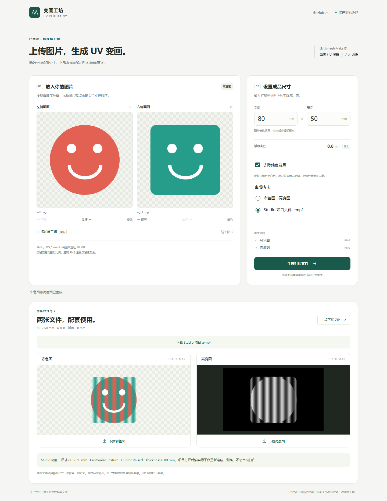

# UV Flip Print · UV 浮雕变画生成器

上传两张图片，生成单面 UV 浮雕变画的**彩色图、高度图和可选 Studio 项目**。支持透明 PNG，无需额外柱镜光栅片。提供本地网页、命令行和 Agent Skill。

Generate paired color/depth maps and optional eufyMake Studio EMPF projects for single-face UV relief flip prints. Local processing, no API key or external lenticular sheet.

**复制给 AI 的提示词：[docs/AI_PROMPT.md](docs/AI_PROMPT.md)** · **[Skill 使用说明](SKILL.md)** · **[编码原理](docs/ALGORITHM.md)**

把两张原图和下面这句话发给支持代码执行的 AI 即可：

> 请按照这个项目的 README，帮我用上传的两张图片制作 UV 变画：https://github.com/October-x/uv-flip-print

AI 会先问你：只生成这次的图片，还是安装完整本地工具、以后重复生成。生成完成后提供彩色图、高度图和简短的 Studio 操作步骤，不另做说明文档。



这是适配 eufyMake E1 的独立社区工具，非安克／eufyMake 官方产品。原双视图流程有制作者实物成功反馈；本仓库的软件测试不等于对任意图片、尺寸和设备的打印保证。三视图标为实验功能。

## 功能

- 两图：左、右观看；三图：左、中、右，实验性。
- 输入成品宽、高；固定 1440 DPI、0.8 mm 浮雕，自动重新计算纹理。
- 保留完整构图和比例；透明区域不加底色，内部白色细节保留。
- 可选去除边缘连通的均匀纯色背景，无云端抠图；复杂背景请先准备透明 PNG。
- 输出配套 PNG、参数／哈希和打印说明 ZIP；可选自包含 `.empf`。
- 所有生成在本机运行，不需要 API key，不连接打印机、不自动打印。

## 本地网页

需要 **Python 3.12**，安装依赖时联网，安装完成后生成可离线运行。

Windows：下载仓库 ZIP 并解压，双击 `setup.cmd`，成功后双击 `start.cmd`。保持终端开启，在网页上传图片、设置尺寸、生成并下载。关闭终端停止服务。

其他系统或手动启动：

```sh
python -m venv .venv
# Windows: .venv\Scripts\activate
# macOS / Linux: source .venv/bin/activate
python -m pip install -r requirements.txt
python run.py
```

浏览器打开 `http://127.0.0.1:8765/uv`。端口占用时用 `python run.py --port 8766`。启动器只绑定 localhost，不能直接作为公网服务部署。

## 给 AI 执行的流程

### 先选择使用方式

收到制作请求时，先用一个简短问题询问，并等用户选择后再开始安装或生成：

> 你想只生成这次的彩色图和高度图，还是把完整工具安装到电脑上，以后自己反复生成？
> 1. 只生成这次的图片。
> 2. 安装完整本地工具，方便重复使用。

用户已经明确说了“只要这次图片”或“安装本地工具”等选择时直接沿用，不重复询问。成品尺寸等未提供的参数使用下文默认值，不增加一轮参数确认。

**选择 1：** 在当前 AI 执行环境临时准备依赖，按下文生成本次图片，不要求用户先安装系统。临时准备生成环境不等于给用户部署完整工具。

**选择 2：** 安装的是本仓库完整的独立 UV 工具，含网页和生成程序，不包含 Spoolio、账号服务或公网部署。先利用已有环境信息判断操作系统和目标目录；仅在确实缺少信息时询问。若能在用户实际电脑执行，就下载完整仓库到独立目录、安装依赖、验证本地页面可用，保留已有文件；否则提供 [完整代码 ZIP](https://github.com/October-x/uv-flip-print/archive/refs/heads/main.zip)，按本页“本地网页”说明协助用户安装。不要把 AI 沙盒中的安装说成已经安装到用户电脑。

本地工具安装后，说明以后只需启动工具、上传新图片、修改尺寸即可反复生成。用户已提供两张原图且当前环境可以执行时，也完成首组生成并按下文交付；尚无图片时可先完成安装，不用示例冒充用户作品。始终只绑定 localhost，不自行开公网端口，也不连接打印机。

### 生成图片

选定使用方式后，按以下步骤完成生成，不要求用户复制技术参数或逐步确认操作：

1. **确定输入。** 默认第一张图片对应从左侧观看，第二张对应右侧；成品 50×50 mm，1440 DPI，浮雕 0.8 mm。用户明确给了顺序或毫米尺寸时优先采用；没有给时直接使用默认值。缺少原图才提示上传，不用示例图替代用户素材。
2. **准备环境。** 取得本仓库完整代码，使用独立 Python 3.12 环境安装 `requirements.txt`。生成不需要 API key、账号或打印机连接。用户原图保留在当前执行环境，不另行上传到其他网站。
3. **保留素材。** 完整构图等比居中适配，不自动裁切、重画、去背景或改变内部白色细节。原透明度保留，不添加底色或棋盘格。只有用户要求时才启用纯色背景移除；复杂背景需用户提供处理好的透明 PNG。
4. **执行生成。** 在仓库根目录运行下方命令，将左右输入路径替换为用户附件的实际路径，输出目录用新的或空的目录。默认不加 `--project`，不连接或操作 Studio。用户改尺寸后重新计算，不单独缩放旧图。
5. **核对输出。** 命令须成功退出；读取标准输出 JSON 中的 `files.color` 与 `files.depth`，检查实际文件存在、像素尺寸相同、配对编号和方向一致。默认 50 mm 对应 2835×2835 px。程序已回读 PNG 验证 DPI／配对信息／CRC；检查比例、透明外缘和主体白色细节。彩色图是条纹交织，灰度图是几何起伏，不能用文生图效果图代替。
6. **交付两图与操作步骤。** 分别给出标明“彩色图 PNG”“高度图 PNG”的真实附件下载链接，标明成品毫米尺寸，并按下方“生成后的回复”附 Studio 设置步骤。脚本附带的参数和 ZIP 用于内部核对，单次生成不主动作为附件发送；不生成 PDF、Word、项目文件或说明文档。用户明确要求其他输出时才提供。

如果当前 AI 不能获取仓库、执行 Python 或返回附件，应简短、如实说明具体限制，提供本地网页运行入口；不能只给伪链接或声称生成成功。三图仅在用户明确要求时启用 `--center`，并标注实验性。

### 生成后的回复

先给两个实际文件的下载链接，再用简短文字说明以下 Studio 操作，毫米尺寸替换为本次实际值：

1. 保存两张 PNG，在 eufyMake Studio 中导入彩色图，将宽、高设为本次成品毫米尺寸。
2. 选择自定义纹理 / Customize Texture，导入配套高度图；两图保持相同尺寸、位置和方向，不单独镜像或缩放。
3. 选择彩色堆高 / Color Raised，厚度设 **0.80 mm**，对比度 **0**、省墨 **0%**、不反相。
4. 根据实际材料快照定位并测高。板材厚度按实物测量，**不是**浮雕的 0.8 mm。
5. 核对预览后先打印一枚小样。修改成品尺寸时重新生成配套文件。

这些步骤直接写在对话回复里，无需另存文档，也不要求用户每一步回复“完成”。若界面不同或用户找不到菜单，再根据其当前截图帮助定位，不编造按钮；打印由用户操作。

## 命令行

在仓库根目录，用已安装依赖的 Python 执行：

```sh
python scripts/generate.py --left left.png --right right.png --width-mm 50 --height-mm 50 --out output/first-print
```

`--left` 指从打印面左侧观看时显示的图片，`--right` 对应右侧；不镜像素材。输出目录须新建或为空，避免覆盖。需要第三幅时加 `--center center.png`；需要纯色去底时加 `--remove-background`；需要额外生成 Studio 项目时才加 `--project`。脚本仍会在输出目录生成参数和 ZIP，AI 默认只向用户提供两张 PNG。

没有图片也可先跑合成图示例：

```sh
python scripts/make_demo.py --out output/demo
```

命令会生成原创几何素材与一组 50 mm 文件，供验证流程，不是实物角度模拟。

AI 需要支持读取仓库、执行 Python 和返回文件；普通聊天窗口不一定具备这些能力。详细请求直接复制 [提示词](docs/AI_PROMPT.md)。Skill 入口位于仓库根目录，可用兼容的 Skill 安装器安装本仓库，安装后仍需满足 Python 依赖。

```sh
npx skills add October-x/uv-flip-print
```

## 在 Studio 打印

1. 保存彩色 PNG 和高度 PNG，打开 Studio。
2. 导入彩色 PNG，核对**成品毫米宽、高**。
3. 自定义纹理 / Customize Texture → 导入配套高度 PNG → 彩色堆高 / Color Raised。浮雕厚度 **0.80 mm**，对比度 0、省墨 0%、不反相；两图保持同尺寸、位置、方向。
4. 按实际平台快照定位，测量材料高度。**3 mm 亚克力是板材厚度，0.8 mm 是表面浮雕高度，两者不同。**
5. 从打印面观看，先打小样，再考虑批量。修改尺寸后重新生成，不能只在 Studio 拉伸旧图。

你可以保存 AI 返回的两图后，按以上步骤自行设置。如果主动选择了项目导出，也可打开 `.empf`，它已包含配套 PNG、毫米尺寸和堆高设置，仍需自己定位测高。

EMPF 使用未加密的本地 ZIP 项目格式，底层导出模块已在 **Studio 4.3.6cn** 实测打开并识别彩色堆高；其他版本需自行核对，打不开时用 PNG 配对导入。默认标准 335×420 mm 平板画布，仅为编辑位置，必须按自己的材料重新定位测高。编辑器白色底图不是打印白底对象。

## 限制与隐私

- 输入 PNG／JPG／静态 WebP，每张 ≤20 MiB、≤2400 万像素；宽高 5–300 mm，同时输出 ≤4000 万像素。100×100 mm 可生成；范围不是试印覆盖范围。
- 无自动裁主体、主体对齐、AI 重绘和复杂场景抠图。原白底默认保留。
- 过渡角度可能混图，透明轮廓会打断凸棱，三图不保证正面清晰或更小切换角度。
- 网页图片和输出只在进程内存保留，最多 6 组、共约 160 MiB，闲置一小时过期；刷新不恢复输入，及时下载。CLI 只写入指定目录。
- 无账号系统；结果链接是临时能力链接，同一本机获得链接的人可访问。不要开放公网端口。
- 本地程序不上传图片；若把图片交给第三方 AI，其处理政策由该平台决定。

## 开发与验证

```sh
python -m pip install -r requirements-dev.txt
python -m pytest tests -q
```

覆盖逐列选帧／高度、透明区零高度、白色细节、尺寸重算、PNG 回读、ZIP 哈希、EMPF 嵌入与毫米尺寸、背景处理、CLI 和本地 API。网页缩略图只预览文件，不模拟实物。

首发验证：28 项测试通过；浏览器实测双图生成、PNG／ZIP 下载、80×50 mm 项目下载、实验三图、390 px 布局及无页面脚本错误。未新增实际打印试验。

## 许可与参考

本工具源代码以 [MIT](LICENSE) 发布，不包含用户原图、设备配置、账号信息或第三方角色素材。依赖分别遵循各自许可。

- [eufyMake UV lenticular printing guide](https://www.eufymake.com/blogs/printing-guides/lenticular-printing)：纹理导入与打印工作流参考。
- [Agent Skills specification](https://agentskills.io/specification)：Skill 包格式。
- [TapuCosmo/empf-generator](https://github.com/TapuCosmo/empf-generator)：公开项目格式互操作参考；本仓库导出模块独立构造自包含项目，没有打包其代码或个人工程模板。
